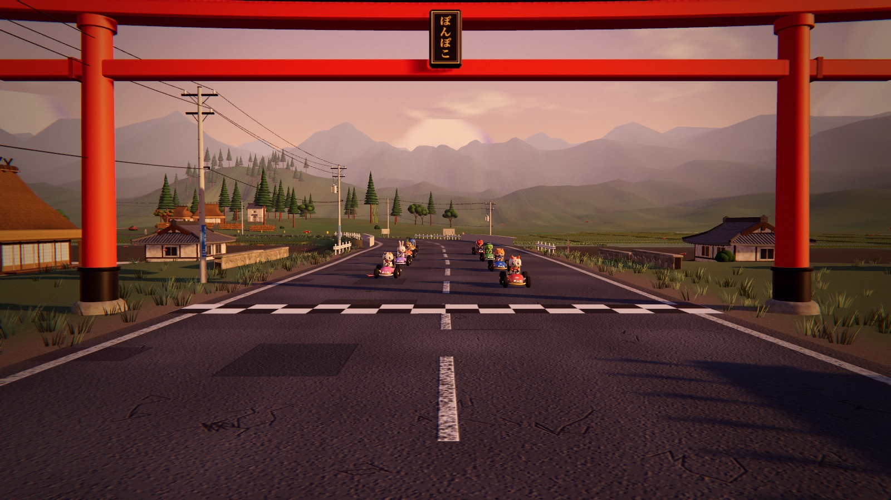
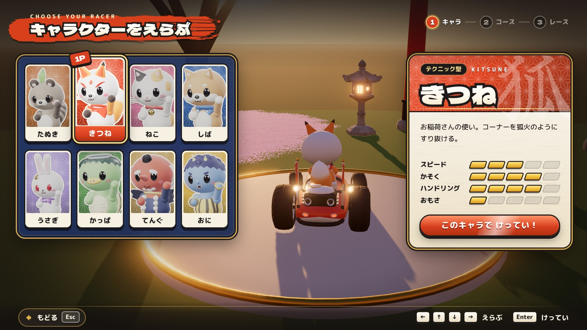
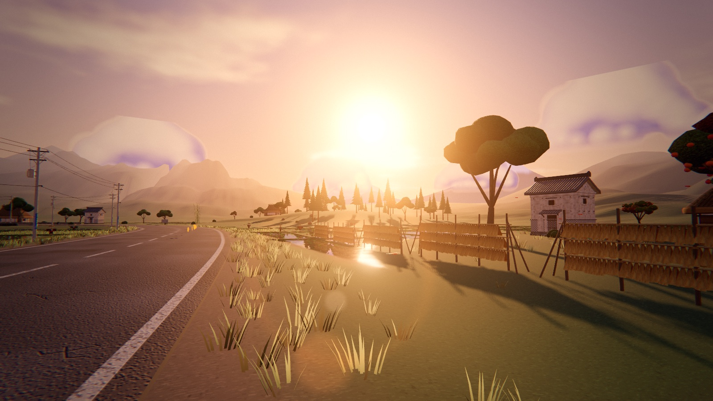
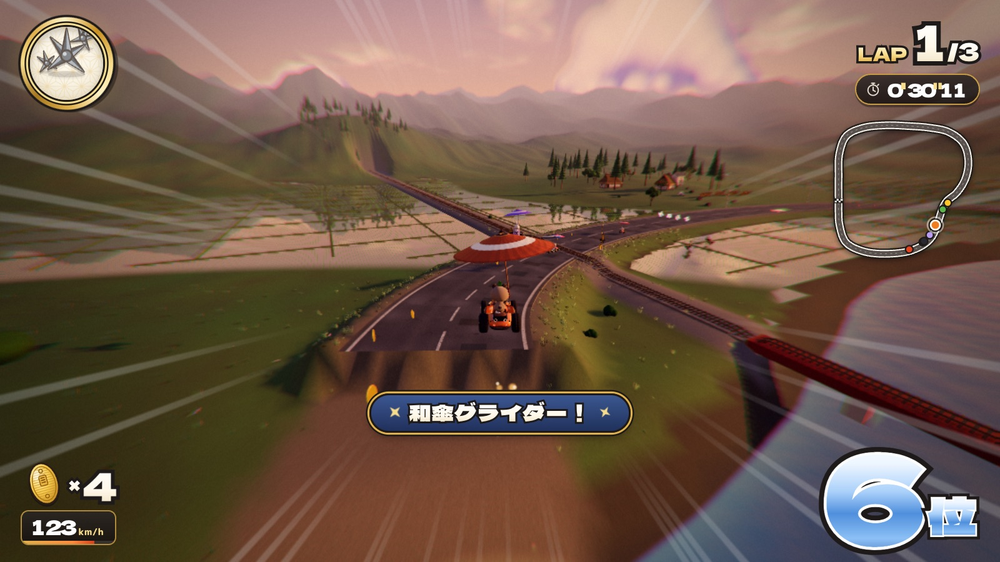
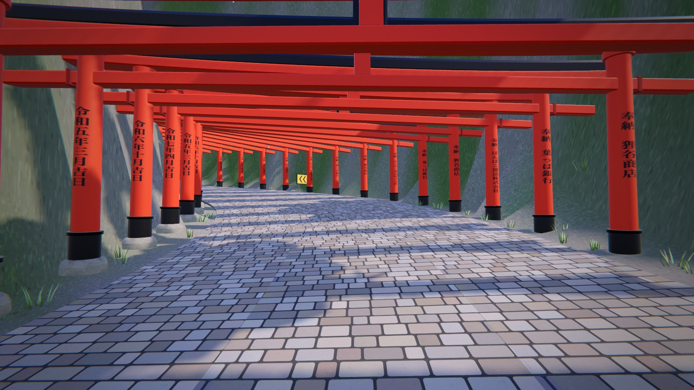
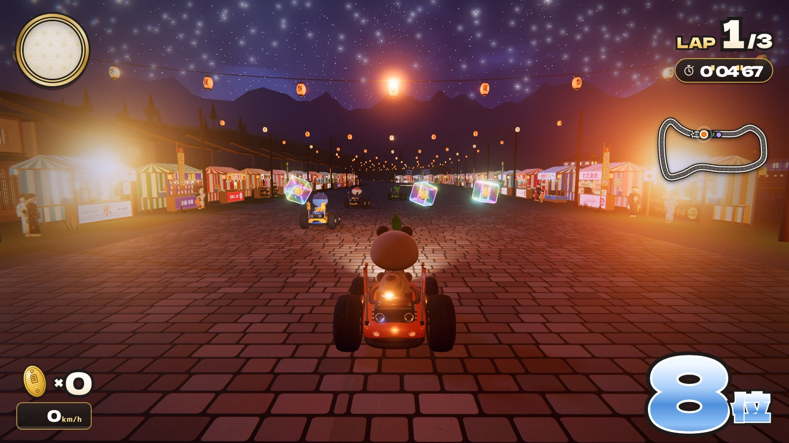
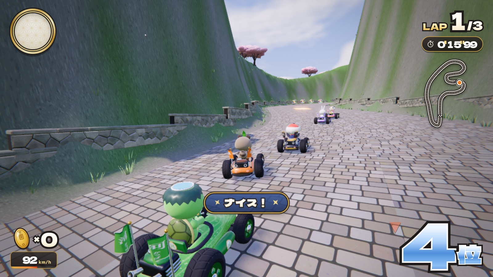

# ぽんぽこカート 〜ニッポン爆走グランプリ〜



**▶ ブラウザで遊ぶ：https://tanuu5.github.io/ponpoko-kart/**

**Claude Code × Claude Opus 5.5（MAX）** で、依頼 1 回・約 1 時間 55 分で作りました（トークン使用量は[制作について](#制作について)に記載）。

和風の 3 コースを 8 人で走る、マリオカート風の 3D カートレースです。
three.js（WebGL）で描画し、地形・建物・キャラクター・カートはすべてコードで生成しています。BGM・効果音・環境音も Web Audio でその場で合成していて、画像ファイルと音声ファイルは 1 つも使っていません。

| | |
| --- | --- |
|  |  |
|  |  |
|  |  |

## コース

| コース | 内容 |
| --- | --- |
| 夕焼けたんぼ道 | 夕日に染まる田んぼの農道。水鏡の田んぼ、ローカル線の踏切（電車に当たると吹っ飛ばされます）、丘の神社から川を越える和傘グライダー。遠くに富士山。 |
| 桜咲く千本鳥居 | 満開の桜の城下町から山道のヘアピンを登り、千本鳥居をくぐって五重塔の境内へ。崖から滝つぼを越えて滑空します。 |
| 夏祭り花火ナイト | 屋台と提灯が並ぶ夜の祭り通り、盆踊りのやぐら、灯籠流しの川、湯けむりの温泉街。花火の下を和傘で川越え。 |

どのコースも 3 周です。難易度は 50cc（ゆったり）・100cc（ふつう）・150cc（はやい）から選べます。

## 操作

| キー | 動作 |
| --- | --- |
| ↑ / W | アクセル |
| ↓ / S | ブレーキ・バック（滑空中は機首上げ） |
| ← → / A D | ハンドル |
| Space / Shift | ジャンプ・ドリフト（押したまま曲がる） |
| E / X | アイテムを使う（↓を押しながらで後ろへ） |
| C | 後ろを見る |
| Esc / P | ポーズ |

ゲームパッドにも対応しています（A：アクセル、B：ブレーキ、RB：ドリフト、LB：アイテム、Y：後ろを見る、Start：ポーズ）。
音はブラウザの仕様上、最初にキーを押すか画面をクリックしてから鳴り始めます。

### テクニック

- **ドリフト＆ミニターボ**：ジャンプボタンを押したまま曲がるとドリフト。火花が青→オレンジ→紫と変わり、離すと色に応じたダッシュ。
- **ロケットスタート**：カウントダウンの「2」が出たあとにアクセルを押すとスタートダッシュ。早すぎるとエンストします。
- **ジャンプアクション**：ジャンプ台やでこぼこで飛んだ瞬間にジャンプボタンでトリック。着地でダッシュ。
- **和傘グライダー**：青く光るジャンプ台から飛び出すと和傘が開いて滑空。空中に浮かぶ小判も狙えます。
- **小判**：拾うごとに最高速が少し上がります（最大 10 枚）。アイテムを当てられると落とします。

## キャラクターとアイテム

キャラクターは たぬき・きつね・ねこ・しば・うさぎ・かっぱ・てんぐ・おに の 8 人。スピード・加速・曲がりやすさ・重さが少しずつ違います。

| アイテム | 効果 |
| --- | --- |
| 三色だんご | ダッシュ（1 本で 3 回まで） |
| だるま | まっすぐ転がり、壁で跳ね返る |
| 手裏剣 | 前のライバルを追いかける |
| まきびし | 後ろに置くワナ |
| 招き猫 | しばらく無敵＆スピードアップ |
| 金ダライ | 自分より前の全員の頭上に落ちてくる |
| 小判 | 小判が 3 枚増える |

## 制作について

企画・ディレクション：**たぬ**　／　開発：**Claude Code（Claude Opus 5.5・推論レベル MAX）**

最初の依頼はこの文章だけでした。

> 技術スタックはお任せしますが、可能な限りリッチな見た目の3Dで、マリオカート風のゲームを作っていただきたい。ステージは日本らしさを感じるもので、例えば田舎の田んぼ道であったり、そう言うラインナップでしょうか。で、アクション性も欲しく、例えば、マリオカート8ではジャンプして空もちょっと飛びますけれど、そう言うギミックも欲しいよね。

設計からコード、演出、テストまでを Claude がひと続きの作業として進めました。
コース・カートの物理・CPU の AI・描画まわりを本体が作り、その間に 6 体のサブエージェントへ並行して任せました。
- 田舎の小物
- 神社と桜の小物
- 夏祭りの小物
- カート・キャラクター・アイテムのモデル
- 音楽と効果音
- メニューと HUD の画面

見た目の確認は、ヘッドレスの Chrome（実機の GPU で描画）でスクリーンショットを撮って行いました。走りの確認は、CPU と同じ AI に自分のカートも運転させる自動操縦で各コースを周回し、詰まる場所やコースアウトしやすい場所を直しています。

### Opus 5.5（MAX）のトークン使用量（ゲーム本体の制作、1 回の依頼ぶん）

| 項目 | 値 |
| --- | --- |
| 制作時間 | 約 1 時間 55 分 |
| API 呼び出し | 841 回（本体 222 ／ サブエージェント 6 体で 619） |
| 出力トークン | 約 291 万 |
| 処理したトークンの合計 | 約 3 億 6,850 万 |
| └ うちキャッシュからの再読み込み | 約 3 億 6,030 万（98%） |
| └ キャッシュへの書き込み | 約 529 万 |
| ソースコード | 約 3 万 2,500 行（JavaScript 77 ファイル ＋ HTML/CSS） |

処理量の大半は「会話の履歴をキャッシュから読み直す」分です。キャッシュの読み込みは通常の入力より大幅に安く扱われるため、見かけの数字ほど重いわけではありません。
この表には、完成後の不具合修正（2 レース目で HUD の表示が止まる件）と、GitHub へ公開する作業のぶんは含めていません。

## 開発

```bash
npm install
npm run dev     # 開発サーバー（http://127.0.0.1:5173/）
npm run build   # dist/ に公開用ファイルを生成
```

GitHub Pages へは、`main` への push で GitHub Actions がビルドして自動で公開します（`.github/workflows/deploy.yml`）。
ビルド結果は相対パスで作っているので、`dist/` の中身はどのパスに置いても動きます。

### 開発用の URL パラメータ

| パラメータ | 内容 |
| --- | --- |
| `?race=inaka` | メニューを飛ばしてすぐレース（`inaka` / `sakura` / `matsuri`） |
| `&char=kitsune` | キャラクター指定 |
| `&cc=150cc` | 難易度指定 |
| `&skipintro=1` | コース紹介カメラを飛ばす |
| `&debug=1` | FPS などを表示 |
| `&autopilot=1` | 自分のカートも自動運転 |
| `&laps=1` | 周回数を変更 |
| `&quality=low` | 水面の反射を切る（軽量化） |

### ファイル構成

| パス | 内容 |
| --- | --- |
| `src/main.js` | 起動処理 |
| `src/core/` | ゲームの進行（Game）、レース管理（Race）、描画とポストエフェクト（Renderer）、カメラ、入力、メニュー |
| `src/track/` | スプラインのコース、路面・ジャンプ台・ダッシュ板のメッシュ、接地判定 |
| `src/kart/` | カートの物理（Kart）、CPU の AI、カート・キャラクター・和傘のモデル |
| `src/items/` | アイテムの動作とモデル、アイコン生成 |
| `src/world/` | 空、地形、水面（平面反射）、草や稲のインスタンス描画、遠景 |
| `src/stages/` | 3 コースそれぞれの地形・配置・演出 |
| `src/props/` | 和風の小物（民家、鳥居、五重塔、屋台、提灯など）の生成 |
| `src/audio/` | 音楽・効果音・環境音の合成 |
| `src/ui/` | タイトル・キャラクター選択・コース選択・HUD・リザルト画面 |
| `tools/` | 開発用ツール（モデルのプレビュー、ヘッドレス Chrome でのスクリーンショットなど） |

## クレジット・ライセンス

- コード：MIT License（[LICENSE](LICENSE)）
- 3D 描画：[three.js](https://threejs.org/)（MIT License）
- フォント：[Dela Gothic One](https://fonts.google.com/specimen/Dela+Gothic+One)、[M PLUS Rounded 1c](https://fonts.google.com/specimen/M+PLUS+Rounded+1c)、[Yuji Syuku](https://fonts.google.com/specimen/Yuji+Syuku)（いずれも SIL Open Font License、Google Fonts から読み込み）

任天堂の「マリオカート」シリーズから着想を得た非公式のファンメイド作品で、任天堂とは関係ありません。キャラクター・コース・音楽はすべてオリジナルです。
